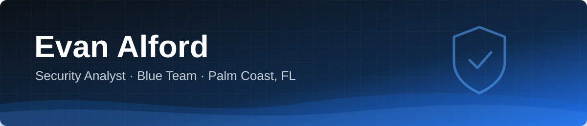

  

  
  
  

## About me

I'm Evan, an entry-level security analyst in Palm Coast, Florida, working toward a Tier 1 SOC role. I hold CompTIA Security+, completed the UCF Cyber Defense Professional Certificate, and I'm working on a B.S. in Cybersecurity at Daytona State College.

I spent most of 2025 in IT support at Publix, working internal staff tickets in ServiceNow by phone and email. Right now I lead a deli team at Publix and spend my off hours in labs: writing detections, breaking my own homelab on purpose, and documenting what I learn here.

- 🔭 Building a SOC detection and triage lab in Splunk with the BOTS v3 dataset
- 🛡️ Running a purple team homelab with Microsoft Defender for Endpoint
- 🤖 Building AI applications like [RAG-BOT](https://github.com/evorg-dotcom/RAG-BOT), and more than halfway through TripleTen's AI Automation program
- 🎯 Practicing on TryHackMe and HackerDNA, where I hold a top U.S. ranking
- 💼 Looking for Tier 1 SOC, junior security analyst, IT support, and entry-level AI engineering roles. Open to relocating.

## Tools I use

  

  
  
  
  
  
  
  
  
  

## Projects

| Project | What it is | Built with |
|---|---|---|
| [**LabScout**](https://github.com/evorg-dotcom/Metasploit-Project) | A lab-only pentesting assistant for one Metasploitable 3 VM. It runs recon from a fixed set of nmap profiles, explains the findings in plain language, and writes a report. A target has to be in private address space and on my allowlist before anything runs, and every action and refusal goes to an audit log. | Python, Nmap, Metasploit RPC |
| [**hello-k8s**](https://github.com/evorg-dotcom/hello-k8s) | A small FastAPI service I containerized, hardened, and deployed to Kubernetes. Non-root multi-stage image, restricted Pod Security Admission, read-only root filesystem, default-deny NetworkPolicy, and a GitHub Actions pipeline with Trivy image and config scans. | Python, Docker, Kubernetes, GitHub Actions |
| [**RAG-BOT**](https://github.com/evorg-dotcom/RAG-BOT) | A chatbot over SharePoint and OneDrive files that only answers from files the asker can open. Each chunk stores its allowed Entra users and groups, Postgres filters on them twice (SQL filter plus row level security), and every question lands in an append-only audit log. | Python, FastAPI, Postgres + pgvector, Ollama, Microsoft Graph |
| [**GearFlo**](https://github.com/evorg-dotcom/GearFlow_2) | A car diagnostics web app I built as a hackathon prototype. Enter symptoms, get likely causes, and keep a history of past diagnostics. | TypeScript, React, Supabase |
| [**Portfolio**](https://evorg-dotcom.github.io) | My personal site, with my projects, experience, training, and certifications in one place. | HTML |

## Education and certifications

- **B.S. Cybersecurity**, Daytona State College (expected 2028)
- **CompTIA Security+** (SY0-701)
- **Cyber Defense Professional Certificate**, University of Central Florida
- **Blue Team Analyst Program**, Ryvora Cyber Range (hands-on training environment)

